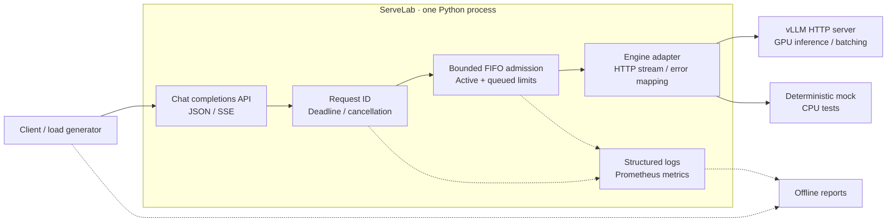
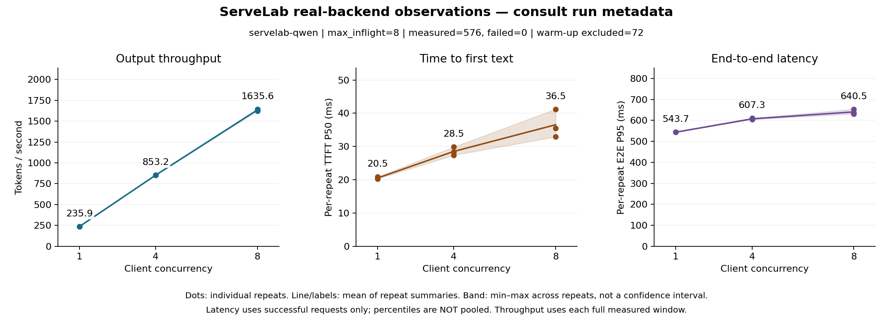

# ServeLab

An asynchronous **Python/FastAPI gateway for LLM inference**, with bounded admission,
cancellation-aware request handling, and reproducible latency/throughput experiments.

[](https://github.com/JerryZJ466/ServeLab/actions/workflows/ci.yml)

**One gateway process · One vLLM backend · JSON + SSE · Measured on one RTX 4090**

> V0.1 functional milestone validated: **576 measured requests**, **15 real-engine
> reliability scenarios**, and **117 passing local tests**. A formal `v0.1.0` tag has
> not been released. This is a serving-systems lab, not a production-ready platform.

## System Architecture



ServeLab owns admission, request lifecycle, error semantics and observability.
**vLLM owns model execution, KV cache management and token-level scheduling.**
The backend is selected at startup; this is not multi-backend load balancing.

Both public response modes use an upstream stream. SSE forwards text incrementally;
JSON aggregates it. Cancelling the request closes the upstream stream and releases
the gateway's capacity. See [architecture](docs/architecture.md) and the
[supported API contract](docs/local-development.md).

## Measured Baseline — RTX 4090 / Qwen2.5-1.5B

A co-located client, gateway and vLLM 0.30.0 served
`Qwen/Qwen2.5-1.5B-Instruct` in FP16 on one 24 GB RTX 4090.

| Client concurrency | Output throughput (token/s) | TTFT P50 (ms) | E2E P95 (ms) | Measured failures |
| --- | ---: | ---: | ---: | ---: |
| 1 | 235.89 | 20.51 | 543.68 | 0 / 192 |
| 4 | 853.22 | 28.52 | 607.32 | 0 / 192 |
| 8 | 1635.61 | 36.54 | 640.45 | 0 / 192 |

Three repeats per concurrency, 64 measured requests per repeat, **72 warm-ups excluded**.
Three short public prompts; observed input lengths 45/46/49 tokens and output length
128 tokens for every measured request. All 576 requests matched their gateway logs.

Values are **means of per-repeat summaries**, not pooled percentiles.
TTFT measures first nonempty text at the streaming client. Client, gateway and engine
shared the rented container; these are loopback results, not internet latency.



Dots are individual repeats; the band is repeat min–max, not a confidence interval.
The [curated report](results/curated/qwen-4090-2026-10-19.json) retains all nine groups,
including P50/P95/P99, TPOT estimates, measurement windows and log-match counts.
[Full environment, launch commands, hashes and caveats →](docs/verification/cloud-baseline.md)

## Key Findings

**Concurrency improves aggregate throughput, with a latency trade-off.**
Concurrency 8 delivered about 6.93× the throughput of concurrency 1, while TTFT and
end-to-end latency increased. This compares the same system at different loads:
it is **not a code-optimization speedup**, a gateway-overhead measurement, or a scheduler ablation.

**Gateway cleanup and engine cleanup require separate evidence.**
For interrupted requests, the gateway released its slots; engine running/waiting gauges
returned to zero, generation counters stopped advancing, and subsequent requests succeeded.
Closing an HTTP connection alone was not used as proof of engine cancellation.

**A throughput benchmark is not a reliability test.**
The main 1/4/8 matrix used eight active gateway slots and did not intentionally overload
admission. Separate one-slot/one-queue tests exercised rejection, queued disconnects and
deadlines. The [CPU mock rehearsal](docs/verification/local-integration.md) separately
illustrates queueing under a two-slot limit; its synthetic rates are not GPU results.

## Reliability Validation

Five real-engine scenarios, each repeated three times against isolated loopback gateways:

| Scenario | Expected contract | Passed |
| --- | --- | ---: |
| Active stream disconnect | Cancel request and reclaim capacity | 3 / 3 |
| Full queue + queue wait timeout | Explicit 429 errors; neither waiting/rejected request admitted | 3 / 3 |
| Queued client disconnect | Remove queued request before dispatch | 3 / 3 |
| Non-streaming deadline | HTTP 504 with `deadline_exceeded` | 3 / 3 |
| Streaming deadline | Explicit SSE error after HTTP 200; no false `[DONE]` | 3 / 3 |

Every scenario was followed by a successful real recovery request.
The logs contain **39 unique terminal records** across cancellations, rejections,
timeouts and recoveries. The uncancelled control generated 748 tokens; interrupted
attempts generated 14–163 tokens before idle was observed.

This supports cleanup under the tested conditions, not exact GPU abort latency,
immediate VRAM release, or long-duration production stability.
[Acceptance method, counter caveats and retained failed harness attempts →](docs/verification/cloud-acceptance.md)

## Quickstart — No GPU Required

Requirements: **Python 3.12, uv, Ubuntu/WSL or Linux**.
The mock emits fixed synthetic text; it downloads no model and performs no inference.

```bash
git clone https://github.com/JerryZJ466/ServeLab.git
cd ServeLab
uv sync --locked
bash scripts/check.sh
uv run --locked python -m servelab.app --config configs/mock.toml
```

In a second Ubuntu/WSL or Linux terminal:

```bash
curl -N http://127.0.0.1:8000/v1/chat/completions \
  -H 'Content-Type: application/json' \
  -d '{"model":"servelab-mock","messages":[{"role":"user","content":"Hello"}],"stream":true}'
```

Use `"stream":false` for a JSON response.
`/healthz`, `/v1/models`, `/info`, and `/metrics` are also available.
Keep the server on loopback: authentication, TLS and multi-worker coordination are
outside this version. [Quickstart details and failure semantics →](docs/local-development.md)

## Reproduce Experiments and Figures

**CPU tool rehearsal**, from the repository root:

```bash
uv run --locked python -m servelab.benchmark.rehearsal
```

It starts its own mock server, runs a repeated 1/4/8 matrix, writes raw rows/logs and
an offline report, then stops the server. Each run uses a new ignored `results/raw/` directory.

**Real GPU experiments:** follow the [actual deployment record](docs/verification/cloud-baseline.md)
for the engine and gateway launch commands, then:

```bash
uv run --locked python -m servelab.benchmark run \
  --config configs/benchmark.qwen.toml --output results/raw

# Separately, with other inference clients idle:
PYTHONPATH=. uv run --locked python scripts/cloud_acceptance.py \
  --engine-url http://127.0.0.1:8001 --model servelab-qwen --repeats 3
```

The model/tokenizer revision and runtime versions are recorded. The original Vast image's
immutable digest was **not resolved**, so this is not a byte-for-byte container reproduction
claim. No GPU rental, large download or engine installation is performed by the local rehearsal.

**Regenerate the checked-in figure** from the curated aggregate:

```bash
uv run --script scripts/plot_benchmark.py \
  results/curated/qwen-4090-2026-10-19.json \
  --output results/raw/replotted-qwen-4090
```

The plotting script declares an isolated Matplotlib dependency. Choose a new output directory.
Both cloud raw-evidence archives were downloaded and hash-verified; the benchmark report
was recomputed locally with identical bytes. Full raw rows/logs remain local and Git-ignored.
The public aggregate can reproduce the figure, **not independently recompute raw percentiles**.
[Evidence index →](docs/verification/README.md) · [Benchmark methodology →](docs/benchmark-methodology.md)

## Scope and Limitations

Implemented: a documented OpenAI-compatible chat-completions **subset**, JSON/SSE,
bounded FIFO admission, deadlines/cancellation, mock/vLLM adapters, structured logs,
Prometheus metrics, and closed-loop benchmark/report tooling.

Not implemented: full OpenAI API compatibility, multi-GPU routing, failover, authentication,
distributed state, autoscaling, Kubernetes, custom GPU kernels or prefill/decode disaggregation.
Only one small model, one GPU and a short-prompt workload were measured; P99 is exploratory,
not a production SLO. See [ADR 0001](docs/adr/0001-v0.1-scope.md).

V0.1 core functional acceptance is complete. Version tagging and the image-identity
reproducibility limitation remain separate release-review items. Later roadmap stages
are optional future directions, not current capabilities.
[Roadmap](docs/roadmap.md) · [Delivery plan](docs/v0.1-execution-plan.md) · [Changelog](CHANGELOG.md)

## Project Structure

```text
servelab/
  app/              # FastAPI app factory and single-process CLI
  api/              # Chat API, JSON/SSE responses, disconnect handling
  core/             # Context, lifecycle, bounded admission, fixed-backend routing
  backends/         # Normalized adapter, mock and vLLM HTTP integration
  observability/    # Structured completion logs and Prometheus metrics
  benchmark/        # Closed-loop runner, raw schemas, offline reports, rehearsal
tests/
  unit/
  integration/
configs/            # Local mock and real-engine experiment configurations
scripts/            # CPU checks, cloud acceptance and figure reproduction
docs/               # Contracts, experiment records, roadmap and figures
results/curated/     # Small public reports; full raw runs stay ignored
```

Presentation follows the architecture → measurements → findings → reproduction structure
of [MiniLlama-Infra](https://github.com/JerryZJ466/MiniLlama-Infra).
Its CUDA ablation results are separate work and are not used as ServeLab measurements.

## License

[MIT](LICENSE)
