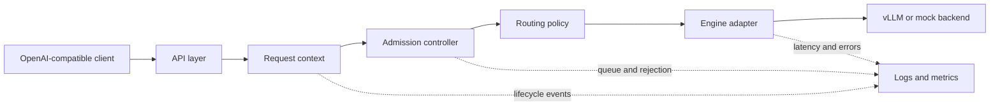

# ServeLab

ServeLab is a production-minded lab for learning and building LLM serving infrastructure. It starts as a small, observable gateway in front of one inference backend and grows toward multi-worker routing, SLO-aware control, trace replay, and reproducible systems experiments.

> Status: planning / pre-v0.1. The repository currently defines the scope and engineering contracts. Implementation will land incrementally with tests and benchmark evidence.

## Why ServeLab?

An inference engine can generate tokens, but a serving platform must also decide:

- whether a request should be admitted or rejected;
- where it should run;
- how timeouts, cancellation, and failures propagate;
- what operators can observe;
- whether a performance claim is reproducible.

ServeLab focuses on this control and integration layer. It does **not** aim to rewrite vLLM/SGLang, train models, or build a chat product.

## V0.1 target

V0.1 is intentionally narrow: one process, one real backend, and a complete request lifecycle.

- OpenAI-compatible `chat/completions` subset
- non-streaming and SSE streaming responses
- request IDs, deadlines, timeout, and cancellation
- bounded admission control with explicit `429` / `503` behavior
- a deterministic mock backend and one vLLM HTTP adapter
- structured logs and Prometheus metrics
- closed-loop benchmarks at concurrency 1, 4, and 8
- raw per-request results plus offline percentile calculation
- unit and integration tests, documentation, and a tagged `v0.1.0` release

Out of scope for V0.1: multi-worker scheduling, SGLang, Kubernetes, Redis, autoscaling, custom CUDA/Triton kernels, and prefill/decode disaggregation.

## Planned architecture



The backend boundary is capability-driven. Gateway code depends on an `EngineAdapter`, not on engine-specific response formats. Routing and admission are separate policies so later experiments can replace one without rewriting the request path.

The canonical lifecycle is:

```text
RECEIVED -> ADMITTED -> DISPATCHED -> FIRST_TOKEN -> COMPLETED
              |             |              |
           REJECTED      FAILED         CANCELLED
                            \----------> TIMED_OUT
```

Transparent failover is allowed only before `FIRST_TOKEN`; after bytes are visible to a client, failures must be explicit.

## Roadmap

| Version | Theme | Main outcome |
| --- | --- | --- |
| V0.1 | Single-backend serving loop | Correct lifecycle, backpressure, observability, and repeatable benchmarks |
| V0.2 | Multi-worker and dual-engine basics | Health-aware routing, safe pre-token failover, vLLM + SGLang adapters |
| V0.3 | SLO and workload experiments | Trace replay, workload estimators, routing baselines, ablations |
| V0.4 | Ecosystem integration | One focused AIBrix or Kubernetes/Gateway API integration |
| V1.0 | Reproducible serving platform | Fixed-version reruns, end-to-end demo, report, and reproducibility bundle |

See [the detailed roadmap](docs/roadmap.md), [architecture contracts](docs/architecture.md), and [benchmark methodology](docs/benchmark-methodology.md).

## Engineering principles

1. Correctness before optimization.
2. Bounded resources instead of hidden queues.
3. Raw evidence before headline numbers.
4. Stable interfaces, replaceable policies.
5. Negative results are still results when the experiment is sound.

## Planned repository layout

```text
servelab/
  app/                 # process entry point
  api/                 # OpenAI-compatible HTTP surface
  core/                # request context, state, admission, routing
  backends/            # adapter interface, mock, vLLM HTTP adapter
  observability/       # structured logs and Prometheus metrics
  benchmark/           # workload runner, schemas, offline reports
tests/
  unit/
  integration/
configs/
docs/
results/               # small curated reports; raw local runs stay ignored
```

## Current next step

The first implementation milestone is the mock-backed vertical slice: accept one request, apply admission control, stream or return a response, record its complete lifecycle, and verify cancellation and timeout behavior in tests. The real vLLM adapter follows only after that path is stable.

## License

MIT
