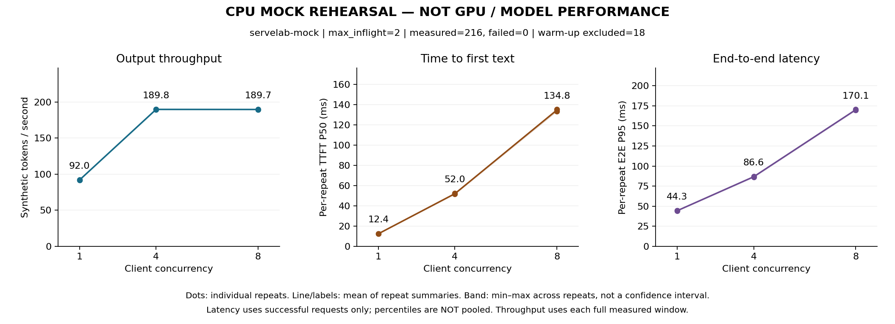
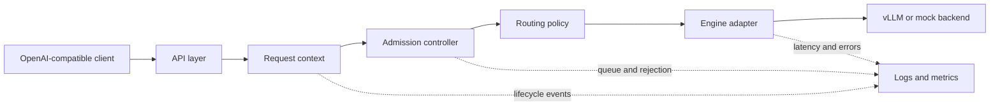

# ServeLab

ServeLab is a production-minded lab for learning and building LLM serving infrastructure. It starts as a small, observable gateway in front of one inference backend and grows toward multi-worker routing, SLO-aware control, trace replay, and reproducible systems experiments.

> Status: local integration and benchmark tooling / pre-v0.1. The gateway, vLLM HTTP adapter, bounded admission, lifecycle handling, logs/metrics, and closed-loop benchmark/report tools are implemented and tested locally and in CPU CI. Real vLLM/model compatibility, GPU cancellation behavior, cloud measurements, and release remain unverified. Mock results are not model-inference performance results.

Published implementation checkpoint: `954e237` — [CPU CI passed](https://github.com/JerryZJ466/ServeLab/actions/runs/39238643144),
110 local tests passed, and the clean-commit mock rehearsal completed with no measured failures.

## Run locally (no GPU)

In Ubuntu/WSL or Linux, from the repository root:

```bash
uv sync --locked
uv run --locked pytest -q
uv run --locked python -m servelab.app --config configs/mock.toml
```

The server binds to `127.0.0.1:8000`. In a second Ubuntu/WSL terminal:

```bash
curl -N http://127.0.0.1:8000/v1/chat/completions \
  -H 'Content-Type: application/json' \
  -d '{"model":"servelab-mock","messages":[{"role":"user","content":"Hello"}],"stream":true}'
```

Set `"stream":false` for a JSON response. `/healthz`, `/v1/models`, and `/metrics` are also available.
The mock always returns fixed text and synthetic token usage; it does not run an LLM.
Use one process only. This lab has no public-facing authentication or multi-worker coordination.

See [local quickstart and API contract](docs/local-development.md),
[current verification evidence](docs/verification/mock-gateway.md), and the
[local-first delivery plan](docs/v0.1-execution-plan.md).

## Rehearse benchmarks locally (no GPU)

In Ubuntu/WSL or Linux:

```bash
bash scripts/check.sh
uv run --locked python -m servelab.benchmark.rehearsal
```

The rehearsal starts its own loopback mock server, runs concurrency 1/4/8 with three
repetitions, excludes warm-up from statistics, saves raw rows and logs, builds an offline
report, and stops its server. Results go to a new directory under ignored `results/raw/`.
No cloud provisioning or model download occurs. See [benchmark usage](docs/benchmarking.md)
and [local integration evidence](docs/verification/local-integration.md).

### Local tool rehearsal — synthetic, not GPU performance



This actual local run completed 216 measured requests with no failures; 18 warm-ups were
excluded. With only two active mock slots, concurrency 4 to 8 adds waiting without meaningful
throughput gain. Lines average per-repeat summaries, not pooled latency percentiles.
See the [curated report, reproduction command and limitations](results/curated/README.md).
Real-model figures will be added only after the cloud experiment.

## Why ServeLab?

An inference engine can generate tokens, but a serving platform must also decide:

- whether a request should be admitted or rejected;
- where it should run;
- how timeouts, cancellation, and failures propagate;
- what operators can observe;
- whether a performance claim is reproducible.

ServeLab focuses on this control and integration layer. It does **not** aim to rewrite vLLM/SGLang, train models, or build a chat product.

## V0.1 target

V0.1 is intentionally narrow: one process, one real backend, and a complete request lifecycle.

- OpenAI-compatible `chat/completions` subset
- non-streaming and SSE streaming responses
- request IDs, deadlines, timeout, and cancellation
- bounded admission control with explicit `429` / `503` behavior
- a deterministic mock backend and one vLLM HTTP adapter
- structured logs and Prometheus metrics
- closed-loop benchmarks at concurrency 1, 4, and 8
- raw per-request results plus offline percentile calculation
- unit and integration tests, documentation, and a tagged `v0.1.0` release

Out of scope for V0.1: multi-worker scheduling, SGLang, Kubernetes, Redis, autoscaling, custom CUDA/Triton kernels, and prefill/decode disaggregation.

## Architecture



The backend boundary is capability-driven. Gateway code depends on an `EngineAdapter`, not on engine-specific response formats. Routing and admission are separate policies so later experiments can replace one without rewriting the request path.

The canonical lifecycle is:

```text
RECEIVED -> ADMITTED -> DISPATCHED -> FIRST_TOKEN -> COMPLETED
              |             |              |
           REJECTED      FAILED         CANCELLED
                            \----------> TIMED_OUT
```

Transparent failover is allowed only before `FIRST_TOKEN`; after bytes are visible to a client, failures must be explicit.

## Roadmap

| Version | Theme | Main outcome |
| --- | --- | --- |
| V0.1 | Single-backend serving loop | Correct lifecycle, backpressure, observability, and repeatable benchmarks |
| V0.2 | Multi-worker and dual-engine basics | Health-aware routing, safe pre-token failover, vLLM + SGLang adapters |
| V0.3 | SLO and workload experiments | Trace replay, workload estimators, routing baselines, ablations |
| V0.4 | Ecosystem integration | One focused AIBrix or Kubernetes/Gateway API integration |
| V1.0 | Reproducible serving platform | Fixed-version reruns, end-to-end demo, report, and reproducibility bundle |

See [the detailed roadmap](docs/roadmap.md), [architecture contracts](docs/architecture.md), and [benchmark methodology](docs/benchmark-methodology.md).

## Engineering principles

1. Correctness before optimization.
2. Bounded resources instead of hidden queues.
3. Raw evidence before headline numbers.
4. Stable interfaces, replaceable policies.
5. Negative results are still results when the experiment is sound.

## Repository layout (V0.1 target)

```text
servelab/
  app/                 # process entry point
  api/                 # OpenAI-compatible HTTP surface
  core/                # request context, state, admission, routing
  backends/            # adapter interface, mock, vLLM HTTP adapter
  observability/       # structured logs and Prometheus metrics
  benchmark/           # closed-loop runner, schemas, offline reports, CPU rehearsal
tests/
  unit/
  integration/
configs/
docs/
results/               # small curated reports; raw local runs stay ignored
```

## Development baseline

The historical Phase A baseline pins the project interpreter and verifies WSL2, Git, Python, pytest, and GPU visibility. The gateway now adds lightweight CPU-only dependencies; no serving engine or model is installed locally.

Run these commands in Ubuntu/WSL:

```bash
cd /home/jerry/code/ServeLab
uv sync --locked
uv run --locked pytest
bash scripts/smoke.sh
```

See [the recorded environment](docs/environment.md) for observed versions, command meanings, and Phase A exit criteria.

## Current next step

Review the local results and prepare a pinned engine/model/container combination and rental budget.
The [Vast.ai runbook](docs/vastai-runbook.md) now proposes a fixed Qwen/vLLM stack, a USD 5
spending ceiling, offer-selection limits, acceptance checks and result-export/cleanup gates.
After explicit approval, rent one GPU, validate the adapter against real vLLM, verify engine-side
cancellation, retain repeated measurements, and prepare the `v0.1.0` release. The adapter uses
HTTP and does not require installing vLLM/PyTorch on the laptop. Protocol fixture success is
not real-engine compatibility evidence.

The [V0.1 execution plan](docs/v0.1-execution-plan.md) defines delivery and release gates.
The [asynchronous waiting exercise](docs/labs/01-async-wait.md) remains optional background, not a prerequisite.

## License

MIT
